<p align="center">
  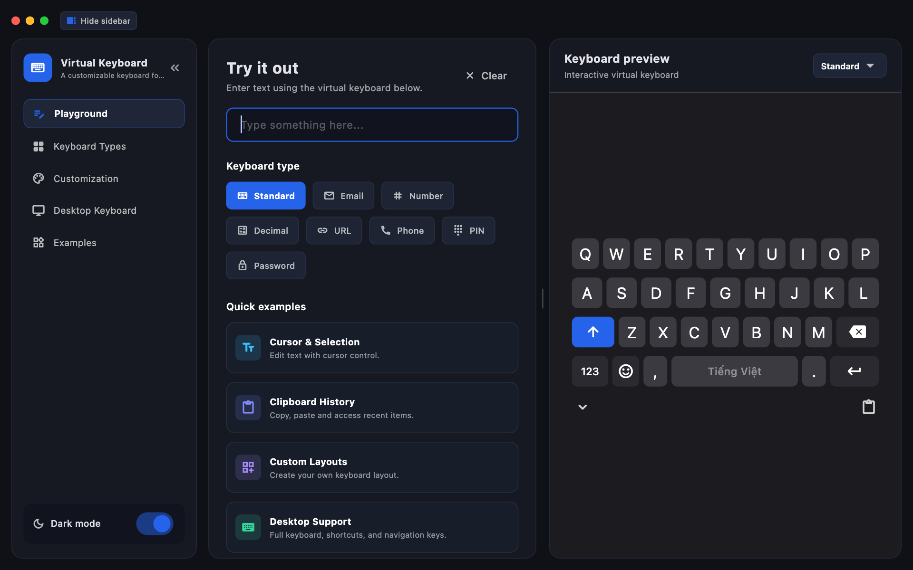
</p>

# flutter_v_keyboard

A customizable virtual keyboard and text-input system for Flutter, built for mobile, desktop, and web.

[](https://pub.dev/packages/flutter_v_keyboard)
[](https://pub.dev/packages/flutter_v_keyboard)
[](https://github.com/tegarnugroho/v_keyboard/blob/main/LICENSE)

Unlike simple keyboard widgets, `flutter_v_keyboard` pairs a drop-in `VTextField` with an on-screen text input engine. It delivers precise cursor management, multi-character selection replacement, multiline editing, layout switching, and focus traversal without invoking the host operating system's software keyboard.

---

## Showcase

### Everyday Typing

| Standard | Number / PIN | Password | Multiline |
| :---: | :---: | :---: | :---: |
| 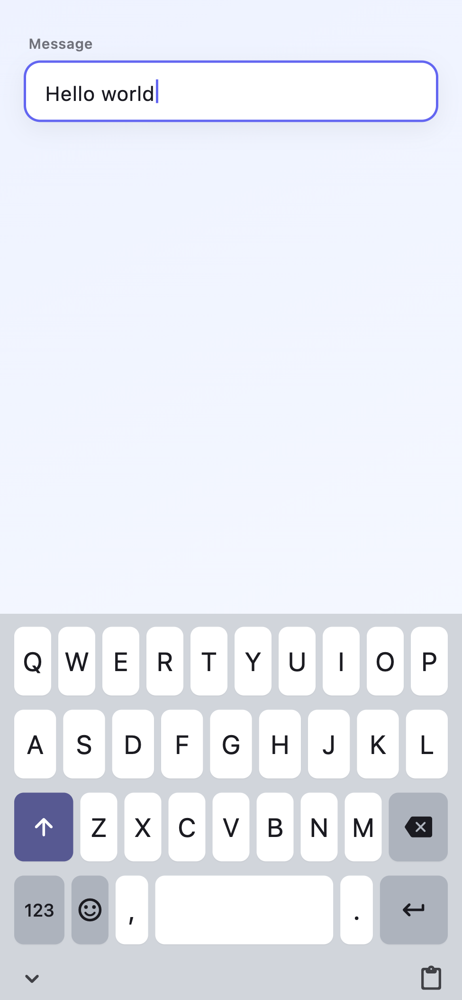 | 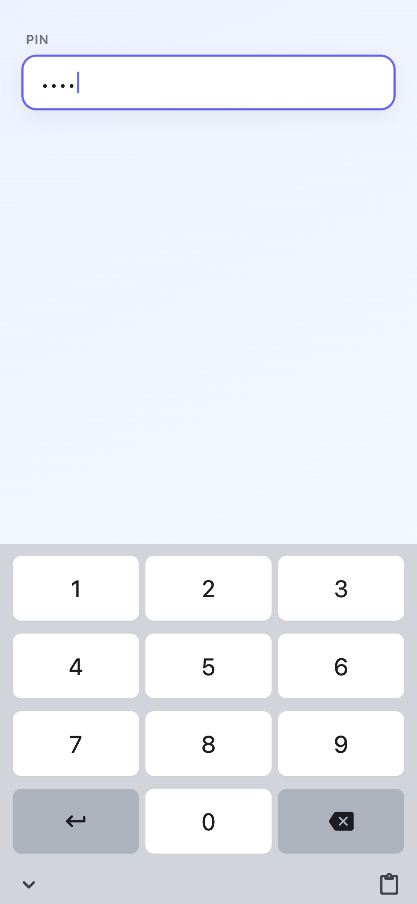 | 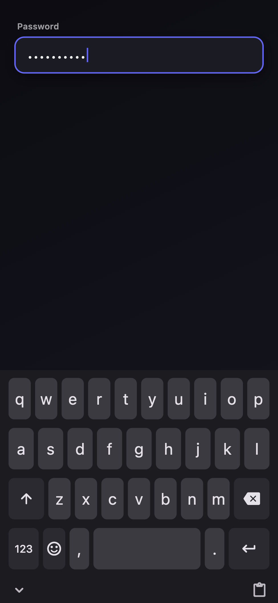 | 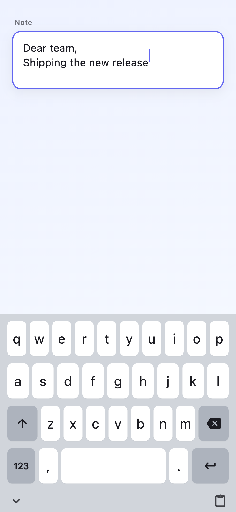 |

### Customization

| Light Theme | Dark Theme | Emoji Panel |
| :---: | :---: | :---: |
|  | 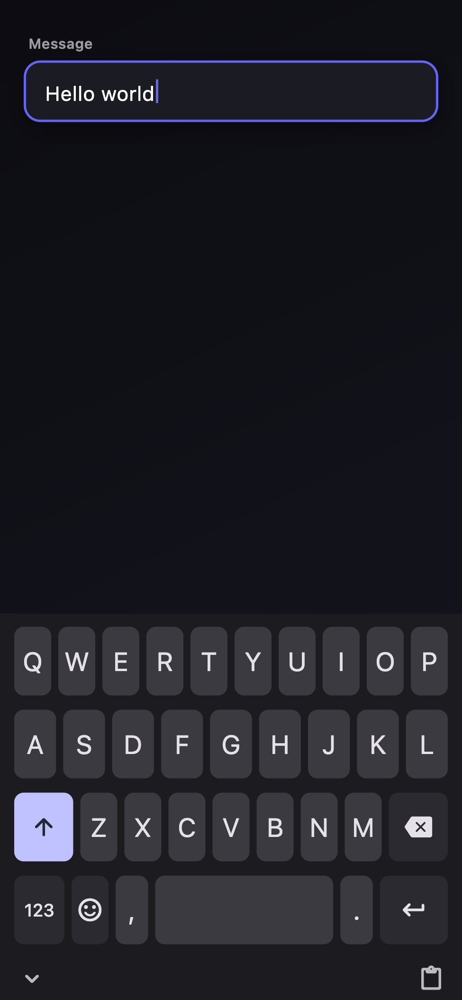 | 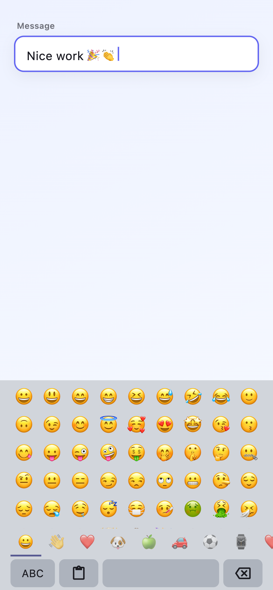 |

### Desktop

Full physical desktop layout featuring function keys, navigation clusters, and responsive collapsing sections.

<p align="center">
  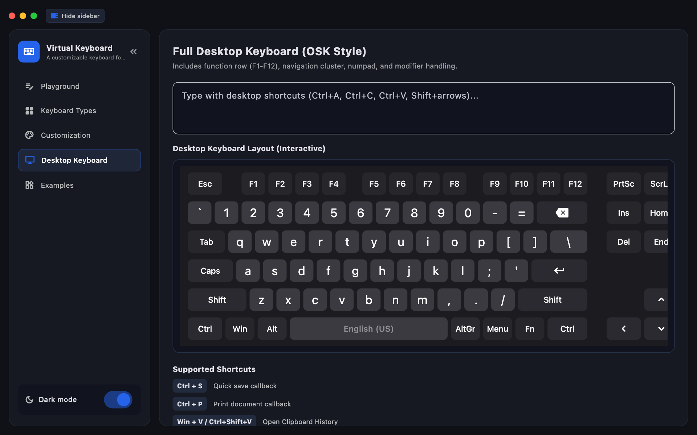
</p>

Responsive scaling across phones, landscape mode, tablets, and wide desktop windows.

<p align="center">
  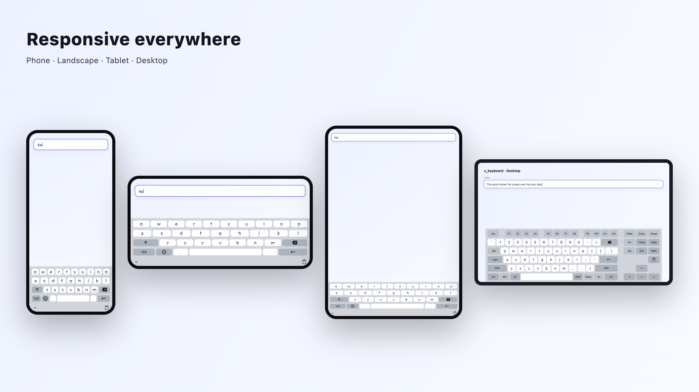
</p>

### Clipboard History

Production-ready clipboard history integrated directly into the virtual keyboard. Tap the clipboard key on the keyboard, search snippets, pin frequent items, and paste directly into the active field.

| Integrated Key | History Panel | Search & Filter |
| :---: | :---: | :---: |
| 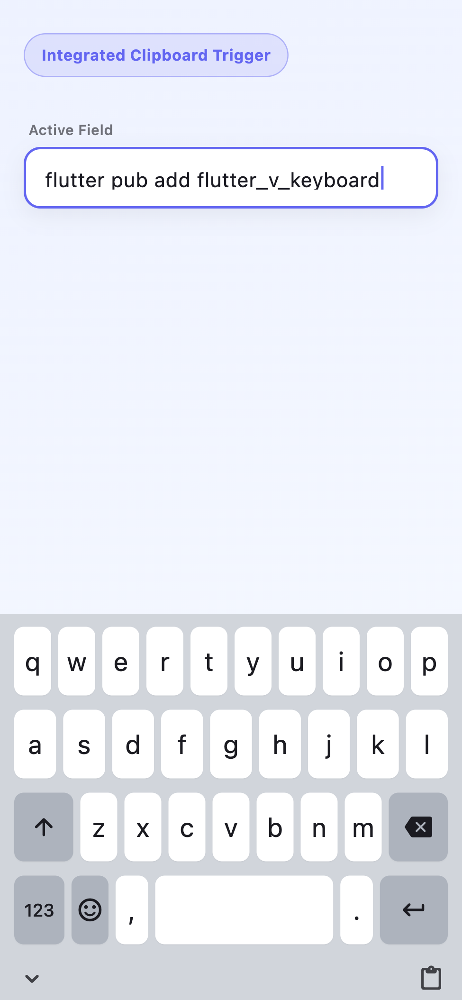 | 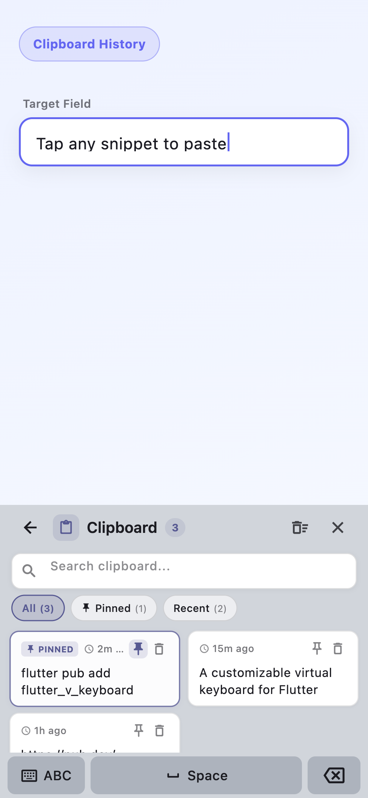 | 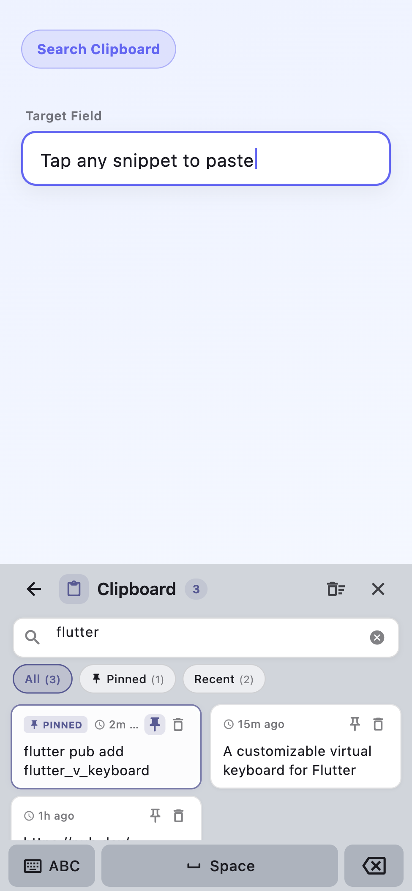 |

---

## Features

### Text Input
- Real cursor positioning, drag selection, and multi-character replacement.
- Multiline editing with newline handling and text overflow wrapping.
- Flutter focus system integration with `TextInputAction` (`next`, `done`, `go`, `search`).
- Native keyboard avoidance by pushing application UI via `viewInsets.bottom`.
- Full respect for `inputFormatters`, `maxLength`, and `readOnly` configurations.

### Keyboard Layouts
- **Alphabetic & Multi-Language**: 13 built-in international layouts (`en_US`, `en_GB`, `de_DE`, `fr_FR`, `es_ES`, `nordic`, `tr_TR`, `ru_RU`, `el_GR`, `ko_KR`, `ja_JP`, `zh_CN`, `zh_TW`).
- **Hangul Syllable Composition Engine**: Pure algorithmic Korean syllable composition (`ㅎ` + `ㅏ` + `ㄴ` = `한`), compound vowels (`ㅘ`, `ㅙ`, `ㅢ`), compound batchim (`닭`), batchim splitting (`간` + `ㅏ` = `가나`, `닭` + `ㅣ` = `달기`), and step-by-step backspace decomposition.
- **Kana Voicing Mark Engine**: Algorithmic dakuten (`゛`) and handakuten (`゜`) sound composer for Japanese typing (`か` + `゛` = `が`, `は` + `゜` = `ぱ`).
- **Runtime Layout Switching**: Hold (long-press) the space bar to open the layout picker dialog / bottom sheet, with space bar active layout preview and persistent selection.
- **Accented Characters**: Long-press letter callouts with customizable alternates.
- **Specialized**: Number, decimal, phone, PIN, password, email, and URL layouts.
- **Symbols**: Multi-page switching (`123`, `#+=`) with sticky shift, double-tap caps lock, and locale-specific currency keys (`€`, `£`, `₺`, `₽`).
- **Emoji**: Built-in categorized emoji picker with zero external dependencies.
- **Custom**: Declarative layout definition and global layout registry (`VKeyboardLayouts`).

### Desktop Experience
- Windows On-Screen Keyboard style layout with function keys (F1–F12) and numpad.
- Full modifier handling: Shift, Ctrl, Alt, AltGr, Meta, Caps Lock, Num Lock, and Scroll Lock.
- Navigation clusters: Arrow keys, Home, End, Page Up, and Page Down.
- Word-by-word navigation (`Ctrl + Arrow`) and word deletion (`Ctrl + Backspace`).
- Hardware keyboard fallback on desktop and web targets.
- Desktop shortcut registration via `VKeyboardShortcuts`.

### Clipboard History
- Automatic recording of copied and cut text snippets within the virtual keyboard pipeline.
- Instant synchronization with the host operating system clipboard upon opening.
- Persistent local storage surviving application restarts.
- Deduplication with position bumping and original timestamp preservation.
- Snippet pinning to protect critical items from eviction.
- Search filtering with quick filter chips (`All`, `Pinned`, `Recent`).
- Privacy protection: Password, PIN, and sensitive fields are never saved.
- Hardware shortcut support (`Win + V`, `Ctrl + Shift + V`).

---

## Installation

Add `flutter_v_keyboard` to your `pubspec.yaml`:

```bash
flutter pub add flutter_v_keyboard
```

Or add it manually under dependencies:

```yaml
dependencies:
  flutter_v_keyboard: ^0.3.0
```

---

## Quick Start

Wrap your application tree once with `VKeyboardScope`:

```dart
import 'package:flutter/material.dart';
import 'package:flutter_v_keyboard/flutter_v_keyboard.dart';

void main() => runApp(const MyApp());

class MyApp extends StatelessWidget {
  const MyApp({super.key});

  @override
  Widget build(BuildContext context) {
    return MaterialApp(
      builder: (context, child) => VKeyboardScope(
        child: child!,
      ),
      home: const FormPage(),
    );
  }
}
```

Replace `TextField` with `VTextField`:

```dart
class FormPage extends StatefulWidget {
  const FormPage({super.key});

  @override
  State<FormPage> createState() => _FormPageState();
}

class _FormPageState extends State<FormPage> {
  final _controller = TextEditingController();

  @override
  void dispose() {
    _controller.dispose();
    super.dispose();
  }

  @override
  Widget build(BuildContext context) {
    return Scaffold(
      appBar: AppBar(title: const Text('Virtual Keyboard Example')),
      body: Padding(
        padding: const EdgeInsets.all(16),
        child: VTextField(
          controller: _controller,
          keyboardType: VKeyboardType.standard,
          textInputAction: TextInputAction.done,
          decoration: const InputDecoration(
            labelText: 'Your message',
            border: OutlineInputBorder(),
          ),
        ),
      ),
    );
  }
}
```

---

## Multi-Language Layouts

`flutter_v_keyboard` includes 13 built-in international layouts and a runtime layout switcher inspired by Gboard and iOS.

### Built-in Locales

| Layout ID | Language | Type | Key Features |
| :--- | :--- | :--- | :--- |
| `en_US` | English (US) | QWERTY | Standard US keyboard, `$` currency symbol (default) |
| `en_GB` | English (UK) | QWERTY | UK symbols with `£` currency symbol |
| `de_DE` | Deutsch | QWERTZ | Swapped `Y`/`Z`, direct `ä`, `ö`, `ü`, `ß` keys, `€` symbol |
| `fr_FR` | Français | AZERTY | Swapped `A`/`Q` and `Z`/`W`, `M` beside `L`, `é`, `è`, `à`, `ç`, `ù`, `€` symbol |
| `es_ES` | Español | QWERTY | Dedicated `ñ` key, `¿`, `¡`, `€` symbol |
| `nordic` | Nordic | QWERTY | Dedicated `å`, `ä`, `ö`, `æ`, `ø` keys, `€`/`kr` symbols |
| `tr_TR` | Türkçe | Turkish Q | Dedicated `ğ`, `ü`, `ş`, `ı`, `ö`, `ç`, `₺`, strict dotted/dotless casing (`i ↔ İ`, `ı ↔ I`) |
| `ru_RU` | Русский | ЙЦУКЕН | Full Cyrillic alphabet, `₽` currency symbol |
| `el_GR` | Ελληνικά | Greek | Full Greek alphabet, `€` currency symbol |
| `ko_KR` | 한국어 | 2-Set Hangul (두벌식) | Algorithmic syllable composition, compound vowels/batchim, `₩` currency symbol |
| `ja_JP` | 日本語 | JIS Kana | Full Kana alphabet, `¥` currency symbol, voicing marks (`゛`, `゜`) |
| `zh_CN` | 简体中文 | Pinyin | Pinyin QWERTY with fullwidth Chinese punctuation (`，`, `。`, `、`), `¥` symbol |
| `zh_TW` | 繁體中文 | Zhuyin (注音) | Complete Bopomofo phonetic alphabet with tone marks and Traditional punctuation |

### Enabling Multi-Language Support

Specify `enabledLocales` using the type-safe `VKeyboardLocale` enum in `VKeyboardConfig` (or use `enabledLayouts` for custom registered layout IDs). When two or more layouts are enabled, holding (long-pressing) the space bar opens the layout picker dialog / bottom sheet:

```dart
VKeyboardScope(
  config: const VKeyboardConfig(
    // Type-safe enum list (use VKeyboardLocale.values to enable all built-in layouts)
    enabledLocales: [
      VKeyboardLocale.enUS,
      VKeyboardLocale.deDE,
      VKeyboardLocale.frFR,
      VKeyboardLocale.esES,
    ],
    defaultLocale: VKeyboardLocale.enUS,
    persistLayoutSelection: true, // Remembers active layout across app restarts
    showGlobeKey: false,          // Optional bottom-bar globe icon (default: false)
  ),
  onLayoutChanged: (layoutId) {
    debugPrint('Layout switched to: $layoutId');
  },
  child: child!,
);
```

### Space Bar & Layout Switcher

- **Hold Space Bar**: Holding (long-pressing) the space bar opens a layout picker (bottom sheet on mobile, dialog on desktop/tablet) to select any enabled layout.
- **Space Bar Active Preview**: When multiple layouts are enabled, the space bar subtly displays the active language name (e.g. `English (US)`, `Deutsch`, `Русский`), matching modern keyboard UX.
- **Switch Banner**: Briefly flashes the new layout name on the space bar (~1.5s) upon switching.
- **Optional Globe Key**: Can be enabled via `showGlobeKey: true` if a dedicated bottom-bar button is desired.
- **Persistent State**: The user's chosen layout is automatically stored locally and restored on next application launch.

### Programmatic Control

Access layout controls from any widget using `VKeyboardController`:

```dart
final controller = VKeyboardController.of(context);

// Read current active layout
final current = controller.currentLayoutId;
final locale = controller.currentLocale; // VKeyboardLocale?

// Switch layout directly using enum or string ID
controller.setLocale(VKeyboardLocale.deDE);
// or: controller.setLayout('de_DE');

// Cycle to next layout
controller.nextLayout();

// Listen to layout changes
controller.onLayoutChanged.listen((id) {
  debugPrint('New layout: $id');
});

// Open layout picker manually
showVKeyboardLayoutPicker(context, controller);
```

### Custom Layout Registration

Register your own custom language layouts globally with `VKeyboardLayouts`:

```dart
VKeyboardLayouts.register(
  myCustomLayout,
  displayName: 'Esperanto',
  nativeName: 'Esperanto',
  shortLabel: 'EO',
);
```

Once registered, custom layouts can be referenced by ID in `enabledLayouts` and `defaultLayout`.

### Long-Press Accents

Character keys can define alternate accented characters via `KeyData.char`:

```dart
KeyData.char('e', alternates: ['é', 'è', 'ê', 'ë'])
```

Long-pressing the key reveals an interactive accent bubble callout above the key. Tapping an alternate inserts it directly into the active text field.

---

## Customization

### Themes

Choose between built-in presets or inherit colors and typography from your application's `ThemeData`:

```dart
// Built-in presets
VKeyboardScope(
  theme: VKeyboardTheme.light(accentColor: Colors.teal),
  child: child!,
);

VKeyboardScope(
  theme: VKeyboardTheme.dark(accentColor: Colors.deepOrange),
  child: child!,
);

// Ambient ThemeData inheritance (with native OS font fallback stack)
VKeyboardScope(
  theme: VKeyboardTheme.fromTheme(Theme.of(context)),
  child: child!,
);
```

### Runtime Configuration

Adjust keyboard behavior and clipboard limits through `VKeyboardConfig`:

```dart
VKeyboardScope(
  config: const VKeyboardConfig(
    hideOnDone: true,
    moveFocusOnNext: true,
    closeOnOutsideTap: true,
    enableLongPressDelete: true,
    enableKeyRepeat: true,
    enableClipboardHistory: true,
    maxClipboardHistoryItems: 50,
  ),
  child: child!,
);
```

### Custom Layouts

Define custom layouts declaratively without modifying package internals:

```dart
final greekLayout = KeyboardLayout(
  id: 'greek',
  initialPage: 'main',
  pages: {
    'main': [
      'αβγδεζηθ'.split('').map(KeyData.char).toList(),
      'ικλμνξοπ'.split('').map(KeyData.char).toList(),
      [
        KeyData.shift(flex: 1.5),
        ...'ρστυφχψ'.split('').map(KeyData.char),
        KeyData.backspace(flex: 1.5),
      ],
      [
        KeyData.space(flex: 5),
        KeyData.enter(flex: 2),
      ],
    ],
  },
);

VTextField(
  keyboardType: VKeyboardType.custom,
  customLayout: greekLayout,
);
```

### Custom Keys

Insert custom widget keys using `KeyData.custom`:

```dart
KeyData.custom(
  builder: (context) => Container(
    alignment: Alignment.center,
    decoration: BoxDecoration(
      color: Colors.amber.shade200,
      borderRadius: BorderRadius.circular(8),
    ),
    child: const Icon(Icons.mic, size: 20),
  ),
  text: '[voice]',
  flex: 1.2,
);
```

### Desktop Keyboard and Shortcuts

Render a full physical keyboard layout with `VKeyboardType.desktop` and bind custom global shortcuts with `VKeyboardShortcuts`:

```dart
VKeyboardShortcuts(
  shortcuts: {
    LogicalKeySet(LogicalKeyboardKey.control, LogicalKeyboardKey.keyS): () {
      debugPrint('Save command invoked');
    },
  },
  onMedia: (intent) => debugPrint('Media key: $intent'),
  onMetaKey: () => debugPrint('Meta / Windows key tapped'),
  child: child!,
);
```

### Sensitive Fields

Exclude sensitive information from clipboard history by setting `sensitive: true`:

```dart
VTextField(
  controller: _pinController,
  keyboardType: VKeyboardType.pin,
  sensitive: true, // Content will never be recorded to clipboard history
);
```

---

## Architecture

`flutter_v_keyboard` is designed around single-responsibility layers:

| Component | Responsibility |
| :--- | :--- |
| `VKeyboardScope` | Injects keyboard overlay, manages bottom safe-area insets (`viewInsets.bottom`), and handles tap-outside dismissal. |
| `VKeyboardController` | Coordinates keyboard state, page switches, active modifiers, and clipboard history. |
| `KeyboardSession` | Links the focused `VTextField` to the controller, synchronizing selection and cursor updates. |
| `TextInputEngine` | Core text manipulation engine handling insertions, deletions, formatters, and length constraints. |
| `KeyboardView` | Computes responsive layout metrics and renders keys with per-key repaint boundaries. |
| `ClipboardHistoryManager` | Records snippets, enforces storage limits, handles pinning, and syncs with system clipboard. |
| `VKeyboardTheme` | Defines visual colors, elevation, border radii, and system font fallback stacks. |
| `VKeyboardConfig` | Controls runtime keyboard behavior flags and feature toggles. |
| `VKeyboardLayouts` | Global registry for built-in and custom locale layouts, AltGr character mappings, and locale metadata. |
| `LayoutSelectionStorage` | Persists user's selected layout across app sessions (file-backed or in-memory). |

---

## Platform Support

| Platform | Support | Status |
| :--- | :---: | :--- |
| **Android** | Supported | Verified via automated widget tests and example runner. |
| **iOS** | Supported | Verified via automated widget tests and example runner. |
| **macOS** | Supported | Verified via automated widget tests, integration tests, and desktop example. |
| **Windows** | Supported | Verified via automated widget tests and desktop example. |
| **Linux** | Supported | Verified via automated widget tests and desktop example. |
| **Web** | Supported | Verified via automated widget tests and Chrome target (storage runs in-memory). |

### SDK Requirements
- **Flutter**: `>=3.22.0`
- **Dart**: `>=3.4.0 <4.0.0`

---

## Contributing & Links

- **Example App**: Explore [`example/lib/main.dart`](example/lib/main.dart) for a comprehensive demonstration of all layouts, themes, and interactions.
- **Changelog**: Review recent updates and breaking changes in [`CHANGELOG.md`](CHANGELOG.md).
- **Issue Tracker**: Report bugs or propose new features on [GitHub Issues](https://github.com/tegarnugroho/v_keyboard/issues).
- **License**: Released under the [MIT License](LICENSE).
